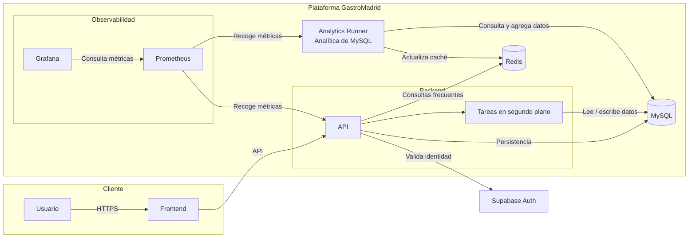
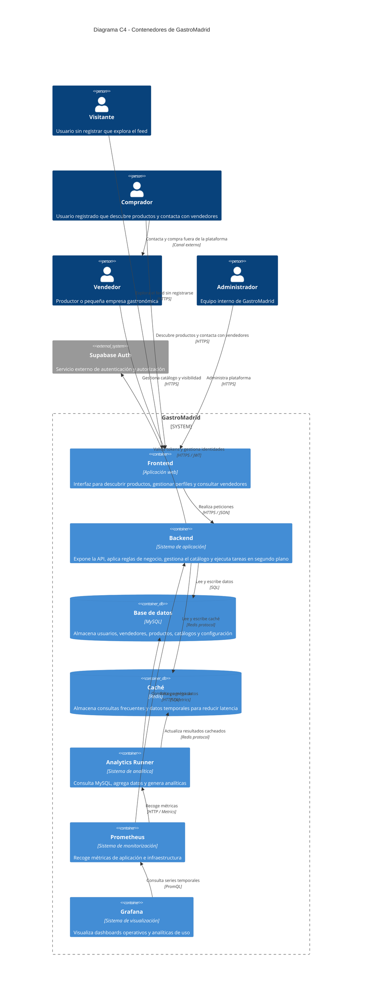
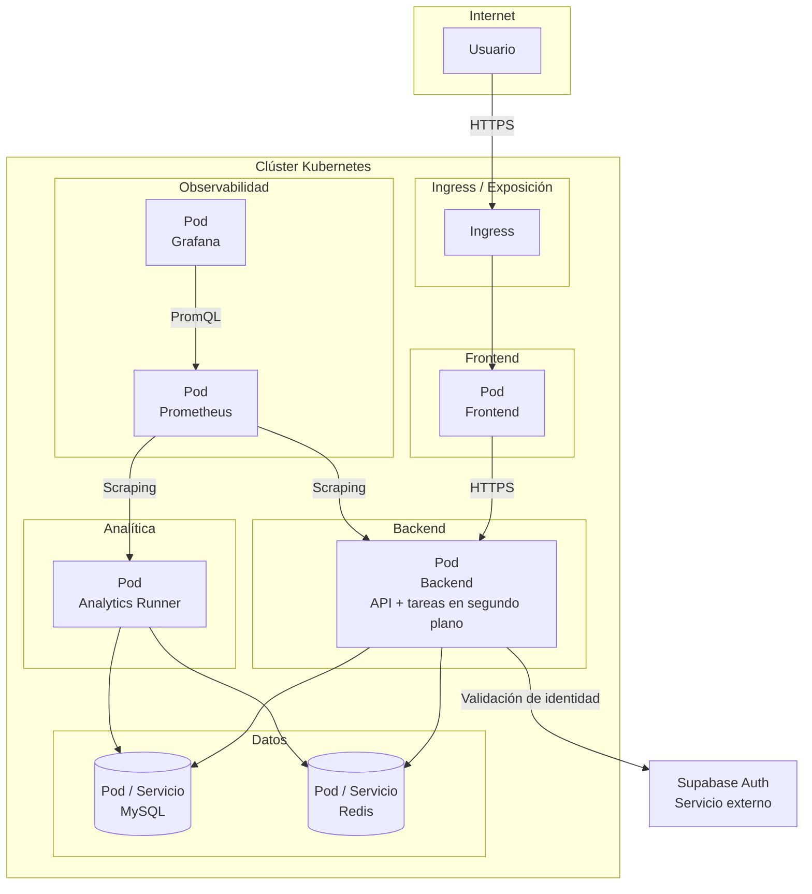

# GastroMadrid

## Estado actual — producto local e inteligencia de mercado

Implementación React/Vite con catálogo de **quesos, vinos y charcutería y embutidos**, panel vendedor local y demostración de inteligencia de mercado. El objetivo actual prioriza promoción de productores y conocimiento agregado de la demanda, con colaboración institucional potencial; no existe financiación confirmada. No hay backend, acceso privado real ni transacciones. Los datos de ejemplo se distinguen de la actividad local consentida.

Consulta [la implementación, las rutas, el modelo de datos y las integraciones pendientes](docs/IMPLEMENTATION.md). El documento conceptual que sigue incluye propuestas históricas de monetización y categorías más amplias; no describe funciones ya desplegadas ni modifica el alcance actual de tres categorías.

**GastroMadrid** es una plataforma para descubrir negocios locales que ofrecen productos gastronómicos de calidad, elaborados por pequeñas empresas y productores que normalmente no tienen presencia en los canales comerciales más visibles.

Su objetivo es acercar a los usuarios un catálogo gastronómico formado por pequeños productores, artesanos y negocios locales de Madrid, facilitando el descubrimiento, la visibilidad y el contacto directo entre compradores y vendedores.

> **Eslogan:** *Viviendo Madrid a través del paladar.*

---

## 1. Misión

Dar visibilidad a las pequeñas empresas gastronómicas de Madrid, conectándolas con consumidores y negocios que buscan productos locales, artesanales y de calidad.

## 2. Visión

Convertirse en la plataforma de referencia para descubrir la gastronomía local de Madrid, dando protagonismo a pequeños productores y fomentando un consumo más cercano, sostenible y consciente.

## 3. Descripción del sistema

GastroMadrid es una plataforma de descubrimiento gastronómico que reúne el catálogo de pequeños productores y negocios locales que ofrecen productos de calidad y que, en muchos casos, no aparecen en los circuitos comerciales habituales.

La plataforma permite a los usuarios explorar productos, conocer a los vendedores y descubrir propuestas gastronómicas fuera de los canales tradicionales. Los vendedores pueden publicar su catálogo y mejorar su visibilidad, mientras que los compradores pueden acceder a planes de suscripción con ventajas exclusivas.

GastroMadrid no es un marketplace ni procesa pagos. Las compras, negociaciones y transacciones se realizan directamente entre comprador y vendedor fuera de la plataforma.

### 3.1 Roles y registro

Antes de iniciar sesión, cualquier persona puede acceder a la vista de **comprador** y explorar el feed de productos y vendedores para descubrir si la plataforma es de su interés.

Al registrarse, el usuario deberá elegir entre dos perfiles:

| Rol               | Descripción                                                  | Ejemplo                                                      |
| ----------------- | ------------------------------------------------------------ | ------------------------------------------------------------ |
| **Comprador**     | Usuario final que descubre productos, consulta fichas, guarda favoritos y contacta directamente con el vendedor. La compra se realiza fuera de la plataforma. | Una persona que busca quesos artesanales para una cena y contacta con un productor local. |
| **Vendedor**      | Pequeña empresa, productor artesanal o negocio gastronómico que publica su catálogo y gestiona su presencia en la plataforma. | Una quesería artesanal, una panadería de masa madre o un productor de miel ecológica. |
| **Administrador** | Usuario interno encargado de moderar contenido, validar vendedores, gestionar planes y consultar métricas de la plataforma. | Un miembro del equipo de GastroMadrid que valida el alta de un nuevo productor. |

### 3.2 Modelo de monetización

GastroMadrid se monetiza sin intervenir en las ventas entre compradores y vendedores.

| Modelo                          | Destinatario         | Descripción                                                  |
| ------------------------------- | -------------------- | ------------------------------------------------------------ |
| **Freemium**                    | Compradores          | Acceso gratuito al catálogo y a las funciones básicas de descubrimiento. |
| **Suscripción premium**         | Compradores          | Eliminación de anuncios y recepción periódica de una **caja sorpresa** con productos seleccionados de vendedores destacados. |
| **Plan de visibilidad**         | Vendedores           | Suscripción que mejora la exposición del vendedor, habilita destacados y aumenta su presencia en los resultados. |
| **Eventos y promociones**       | Vendedores           | Participación en eventos, campañas temáticas y acciones promocionales organizadas por GastroMadrid. |
| **Analítica y datos agregados** | Terceros autorizados | Exportación de métricas agregadas y anonimizadas sobre demanda, categorías y tendencias gastronómicas. |

#### Planes de suscripción para compradores

Los planes de suscripción están dirigidos a compradores. Todos los planes eliminan los anuncios, pero se diferencian por el número y la calidad de los productos incluidos en la caja sorpresa.

| Plan        | Precio orientativo | Productos incluidos | Beneficios                                                   |
| ----------- | -----------------: | ------------------: | ------------------------------------------------------------ |
| **Pequeño** |         20 € / mes |         5 productos | Sin anuncios y caja sorpresa básica.                         |
| **Mediano** |         25 € / mes |         7 productos | Sin anuncios y caja sorpresa ampliada.                       |
| **Alto**    |         45 € / mes |        10 productos | Sin anuncios y caja sorpresa premium, con una selección de mayor calidad o exclusividad. |

> **Nota:** completar con cifras oficiales de precios, periodicidad de entrega —mensual, trimestral o cuatrimestral—, número exacto de productos, criterios de selección y valor estimado de cada caja.

---

## 4. Stack tecnológico

| Capa             | Tecnología       | Función                                                |
| ---------------- | ---------------- | ------------------------------------------------------ |
| Frontend         | React + Vite     | Interfaz web y experiencia de usuario                  |
| Backend          | Python + FastAPI | API REST, lógica de negocio y tareas en segundo plano  |
| Autenticación    | Supabase Auth    | Registro, inicio de sesión, JWT y autorización         |
| Persistencia     | MySQL            | Almacenamiento relacional de datos del sistema         |
| Caché            | Redis            | Reducción de latencia y descarga de la base de datos   |
| Analítica        | Python runners   | Procesos para analítica y agregación de datos de MySQL |
| Monitorización   | Prometheus       | Recolección de métricas                                |
| Visualización    | Grafana          | Dashboards y análisis operativo                        |
| Containerización | Docker           | Empaquetado reproducible de los servicios              |
| Orquestación     | Kubernetes       | Despliegue, escalado y gestión de contenedores         |

---

## 5. Arquitectura del sistema

GastroMadrid sigue una arquitectura cliente-servidor containerizada con Docker y orquestada mediante Kubernetes.

El frontend se comunica con el backend mediante una API. El backend gestiona la lógica de la aplicación, valida la identidad del usuario con Supabase Auth, consulta MySQL y utiliza Redis como capa de caché. Las tareas en segundo plano forman parte del propio backend, mientras que el **Analytics Runner** se encarga de consultar MySQL, agregar datos y generar analíticas.

### 5.1 Componentes principales

- **Frontend:** interfaz que muestra el feed, el catálogo, los perfiles y las vistas de comprador y vendedor.
- **Backend:** servicio que expone la API, aplica las reglas de negocio y ejecuta internamente las tareas en segundo plano.
- **Supabase Auth:** servicio externo responsable de la autenticación, la emisión de tokens y la autorización.
- **MySQL:** base de datos relacional donde se almacenan usuarios, vendedores, productos, catálogos y configuración.
- **Redis:** caché utilizada para acelerar consultas frecuentes y reducir la carga sobre MySQL.
- **Analytics Runner:** proceso independiente encargado de consultar MySQL, agregar datos y generar analíticas.
- **Prometheus y Grafana:** capa de observabilidad para recoger, almacenar y visualizar métricas.

### 5.2 Flujo principal

1. El usuario accede al frontend desde el navegador.
2. El frontend solicita autenticación a Supabase Auth y obtiene un token.
3. El frontend envía peticiones al backend incluyendo el token.
4. El backend valida el token con Supabase Auth.
5. Para consultas frecuentes, el backend comprueba primero Redis.
6. Si no existe caché, el backend consulta MySQL y almacena el resultado temporalmente en Redis.
7. Las tareas en segundo plano se ejecutan dentro del backend.
8. El Analytics Runner procesa datos de MySQL para generar métricas y analíticas.
9. Prometheus recoge métricas del backend y del Analytics Runner; Grafana las visualiza en dashboards.

---

## 6. Diagrama C4: contenedores

El siguiente diagrama utiliza el modelo **C4**, concretamente una vista de contenedores. Representa los principales componentes software, sus responsabilidades y relaciones.

> **Nota:** el soporte de diagramas C4 en Mermaid es experimental y su sintaxis puede variar entre versiones. Si el visor no renderiza `C4Container`, el diagrama de arquitectura con `flowchart` sigue siendo compatible.

---

## 7. Vista de despliegue

La aplicación se despliega como un conjunto de contenedores Docker orquestados por Kubernetes. El backend es un sistema cerrado que incluye tanto la API como las tareas en segundo plano.

---

## 8. Posibilidades a futuro

- Chatbot de descubrimiento gastronómico y asistencia al usuario.
- Nuevos perfiles, como críticos gastronómicos, influencers o asociaciones sectoriales.
- Compra y reserva directamente desde la aplicación mediante integraciones externas.
- Recomendaciones personalizadas basadas en preferencias y comportamiento de navegación.
- Mapa interactivo de productores y rutas gastronómicas por Madrid.
- Ampliación de la analítica con modelos predictivos de demanda y tendencias.

## 9. Dimensión ética, moral y religiosa del proyecto

### 9.1 Significado inmediato del reto de negocio

El reto de negocio de GastroMadrid consiste en mejorar la visibilidad de pequeños productores y negocios gastronómicos locales que, pese a ofrecer productos de calidad, tienen dificultades para competir con las grandes marcas y los canales comerciales más visibles.

El significado inmediato es, por tanto, **reducir la desigualdad de visibilidad** dentro del sector gastronómico. La plataforma no busca sustituir la relación comercial entre comprador y vendedor, sino facilitar que ambos puedan descubrirse y conectar. Aplus Gastromarketing entiende la gastronomía como un motor de desarrollo económico y social, y trabaja para poner en valor productos, territorios y operadores del sector HORECA.

### 9.2 Propósito de la misión

La misión de GastroMadrid tiene un propósito doble:

- **Económico:** ayudar a pequeños productores y negocios locales a alcanzar mayor visibilidad, mejorar su posicionamiento y acceder a nuevas oportunidades de contacto con compradores.
- **Social y cultural:** promover el consumo de productos locales y artesanales, acercar a las personas a la gastronomía de su territorio y contribuir a mantener viva la diversidad gastronómica de Madrid.

En este sentido, la misión no se limita a promocionar productos: busca dar relevancia a personas, oficios y formas de producción que forman parte del patrimonio gastronómico local. Aplus Gastromarketing plantea la gastronomía como cultura, territorio, consumo, experiencia y negocio, lo que refuerza esta visión integral del sector. [24]

### 9.3 Lectura ética y moral

Desde una perspectiva ética, GastroMadrid responde a una idea sencilla pero importante: **la comida no debería desperdiciarse ni su valor debería quedar oculto**. En un contexto en el que muchas personas pasan hambre mientras se desperdician alimentos, dar visibilidad a productos locales de calidad puede contribuir a un consumo más consciente, cercano y responsable.

La plataforma puede fomentar valores como:

- **Valoración del alimento:** reconocer el trabajo, el tiempo y los recursos que existen detrás de cada producto artesanal.
- **Consumo responsable:** favorecer productos locales, de proximidad y elaborados por pequeños productores.
- **Equidad de oportunidades:** ofrecer visibilidad a negocios que no disponen de los recursos de las grandes empresas.
- **Sostenibilidad:** impulsar una gastronomía más consciente con el territorio, la producción local y la reducción del desperdicio.
- **Comunidad:** fortalecer la relación entre productores, compradores y territorio.

### 9.4 Posible sentido religioso

Aunque GastroMadrid no tiene una finalidad religiosa explícita, su actividad puede relacionarse con valores presentes en distintas tradiciones religiosas y humanistas: la gratitud por el alimento, la solidaridad con quien lo produce, la moderación en el consumo y el deber de no desperdiciar lo que otras personas necesitan.

En muchas tradiciones, compartir el pan y valorar la comida tienen un significado que va más allá de la nutrición: representan hospitalidad, comunidad, cuidado del prójimo y reconocimiento de la dignidad del trabajo humano. Bajo esta lectura, la misión de GastroMadrid puede entenderse como una forma de **poner en valor el alimento, a quien lo elabora y a la comunidad que lo comparte**.

Si se desea expresar de forma más prudente, puede afirmarse que el proyecto **no posee un significado religioso explícito**, pero su propósito es compatible con valores éticos y espirituales ampliamente compartidos: cuidado del alimento, justicia hacia los pequeños productores, sostenibilidad y responsabilidad social.

